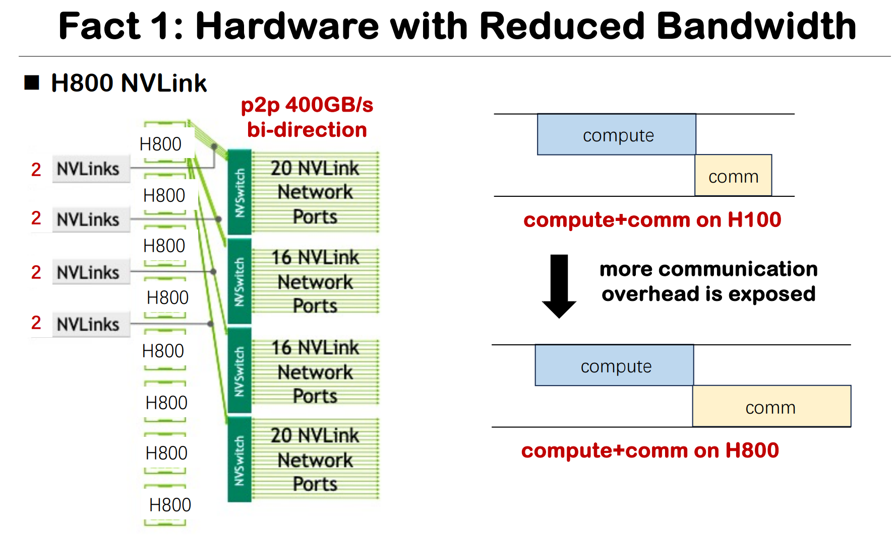
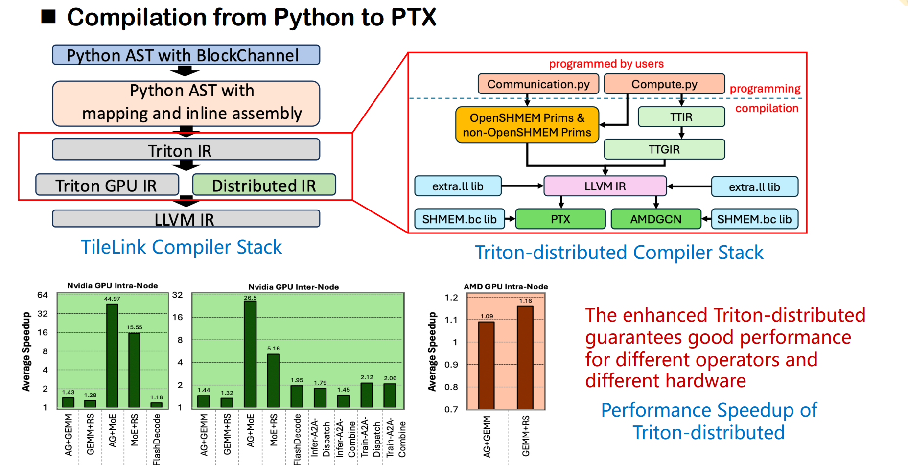
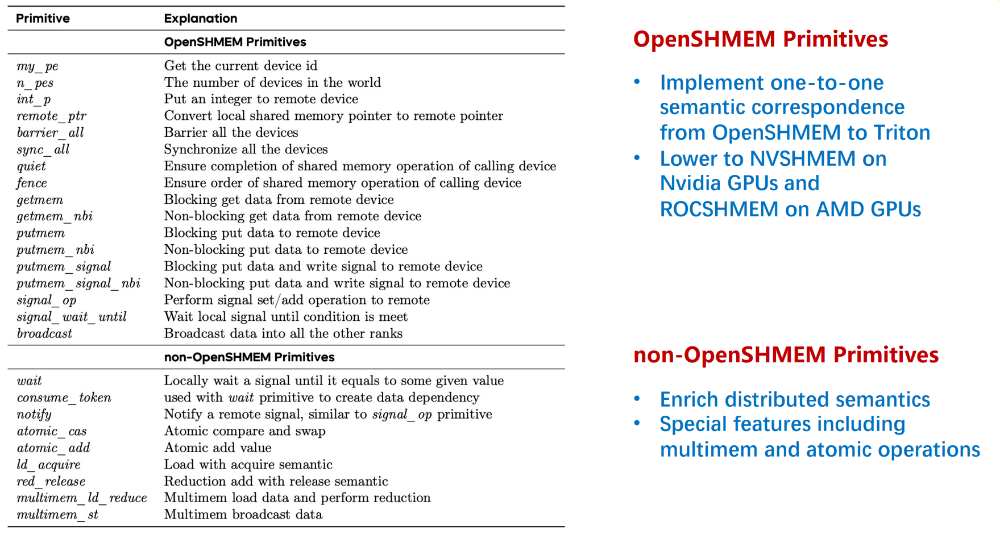
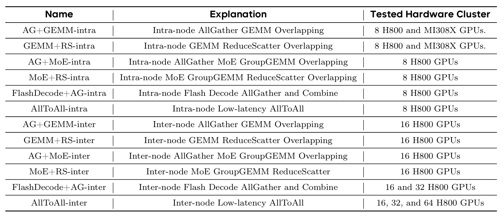
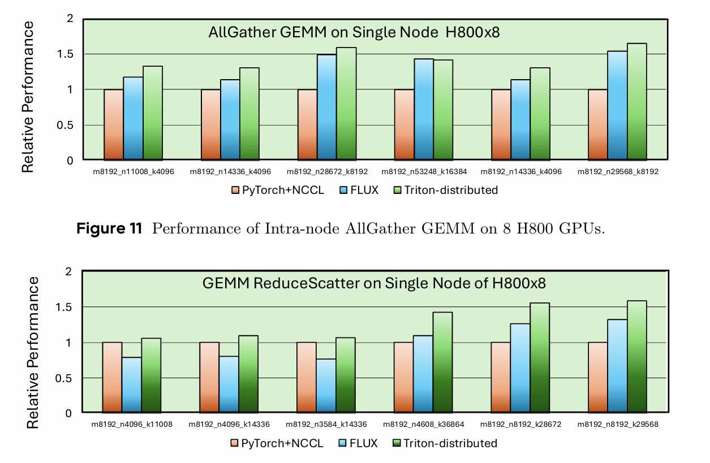
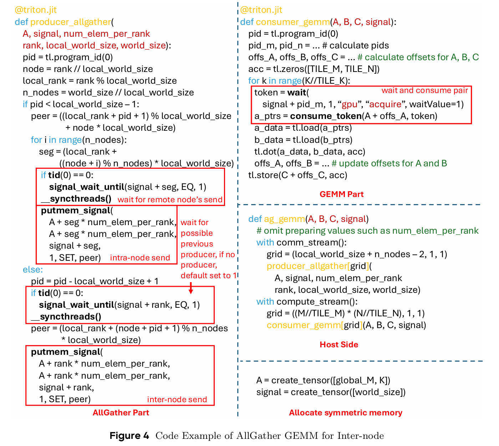
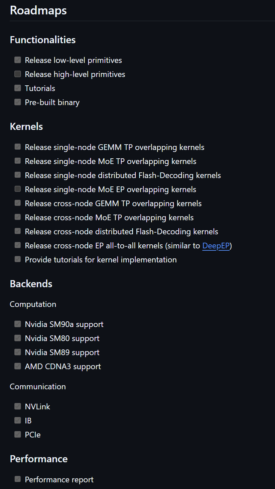
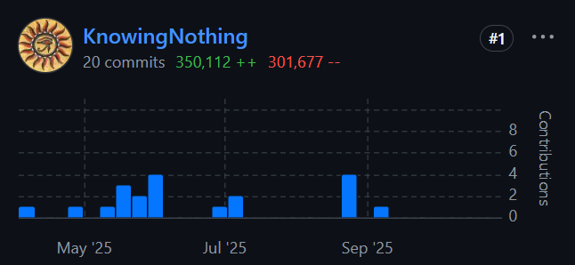
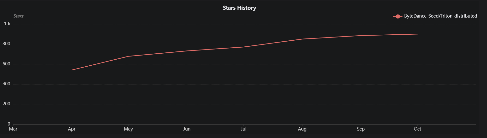
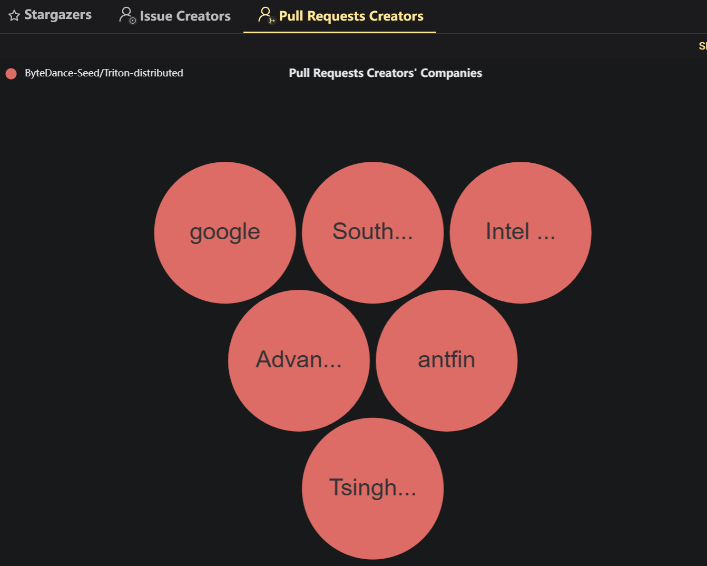

# Triton Distributed 洞察

## 了解软件

Triton-distributed is a distributed compiler designed for computation-communication overlapping, which is based on OpenAI Triton.

Triton-distributed is the first compiler that supports native overlapping optimizations for distributed AI workloads, providing a good coverage of existing optimizations from different frameworks.

[Paper](https://arxiv.org/pdf/2504.19442)

[github](https://github.com/ByteDance-Seed/Triton-distributed)

### Background

- Distributed programming is notoriously difficult. Distributed development generally requires programming in CUDA/C++
- The outstanding compilers that have withstood the test of time (MLIR, Triton, TileLang) still mainly focus on single-device scenarios
- Hardware with reduced bandwidth influences MFU(Model FLOPS Utilization)

### Architecture

Users can program communication and computation parts separately in Python. The communication part is implemented with OpenSHMEM primitives, which are further lowered to LLVM IR along with a bitcode library. The computation part goes through the original Triton compilation stack to LLVM IR. Finally, PTX or AMDGCN are generated and executed on target accelerators. 

对原有的 Triton IR 做了扩展，新增了一套面向分布式语义的 IR 层

### Features
Triton-distributed supports native fine-grained computation-communication overlapping using compiler
assisted primitives. Both computation implementation and communication optimization are fully achieved at the Python level, yielding performance comparable to or better than CUDA/C++ implementations. 
Triton-distributed 编程仅需对 Triton 做较小量的修改

### Primitives

通信-计算融合的优化能力，应由编译器层承担，以应对复杂模型结构和多样硬件环境，避免重复手工实现带来的开发负担。

两层通信原语抽象

第一层是偏高层的原语，主要在 tile 粒度上完成计算调度，并提供面向通信的抽象接口。
第二层则更贴近底层实现，采用了一套类似于 Open Shared Memory 标准（OpenSHMEM）的原语体系。

### Optimized Kernels


### Performance


### Coding Example

[AllGather+GEMM Source code](https://github.com/ByteDance-Seed/Triton-distributed/blob/main/tutorials/07-overlapping-allgather-gemm.py)

```
@triton.jit
def producer_consumer_kernel(
    rank: tl.constexpr,
    num_ranks: tl.constexpr,
    input_ptr,
    output_ptr,
    num_inputs: int,
    queue_ptr,
    signal_ptr,  # *Pointer* to signals.
    queue_size: tl.constexpr,  # The length of queue in unit of BLOCKs
    BLOCK_SIZE: tl.constexpr,  # The size of each BLOCK
    NUM_PRODUCER_SMS: tl.constexpr,
    NUM_CONSUMER_SMS: tl.constexpr,
):
    pid = tl.program_id(0)
    # This kernel issues async-tasks to two group of blocks
    if pid < NUM_PRODUCER_SMS:
        #
        # Producer
        #
        peer_rank = (rank + 1) % num_ranks  # Peer is the next rank
        offs = tl.arange(0, BLOCK_SIZE)
        for i in range(pid, num_inputs, NUM_PRODUCER_SMS):
            queue_offset = i % queue_size
            queue_repeat = i // queue_size
            token = dl.wait(
                # Use `symm_at` to map the data pointer to remote peer rank
                dl.symm_at(signal_ptr, peer_rank) + queue_offset,
                1,  # The number of signals to wait
                "sys",  # The scope of the barrier, `gpu` or `sys`
                "acquire",  # The semantic of the wait
                waitValue=queue_repeat *
                2,  # The value expected, should conform to certain order
            )  # This wait ensures that the corresponding position is empty
            input_ptr = dl.consume_token(
                input_ptr,
                token)  # consume the token to make sure the `wait` is needed
            data = tl.load(input_ptr + i * BLOCK_SIZE + offs)
            # Use `symm_at` to map the data pointer to remote peer rank
            tl.store(
                dl.symm_at(queue_ptr, peer_rank) + queue_offset * BLOCK_SIZE +
                offs, data)
            # need a syncthreads to make sure all the data has been sent
            __syncthreads()
            # `notify` is also single thread scope, we need to use a different thread from `wait`
            dl.notify(
                signal_ptr + queue_offset,
                peer_rank,  # Notify the signal object on the peer rank
                signal=queue_repeat * 2 + 1,  # Write a value to the signal
                sig_op="set",  # Set the value. Another choice is `add`
                comm_scope=
                "intra_node",  # This example is intra-node, another choice is `inter_node`
            )  # This notifies the consumer that the data is ready
    elif pid < NUM_PRODUCER_SMS + NUM_CONSUMER_SMS:
        #
        # Consumer
        #
        pid = pid - NUM_PRODUCER_SMS
        offs = tl.arange(0, BLOCK_SIZE)
        for i in range(pid, num_inputs, NUM_CONSUMER_SMS):
            queue_offset = i % queue_size
            queue_repeat = i // queue_size
            token = dl.wait(
                signal_ptr +
                queue_offset,  # The base *Pointer* of signals at the current rank
                1,  # The number of signals to wait
                "sys",  # The scope of the barrier
                "acquire",  # The semantic of the wait
                waitValue=queue_repeat * 2 + 1,  # The value expected
            )  # This wait ensures that the corresponding position is full
            queue_ptr = dl.consume_token(queue_ptr, token)
            data = tl.load(queue_ptr + queue_offset * BLOCK_SIZE + offs)
            tl.store(output_ptr + i * BLOCK_SIZE + offs, data)
            __syncthreads()
            dl.notify(
                signal_ptr + queue_offset,
                rank,  # Notify the signal object on the current rank
                signal=queue_repeat * 2 + 2,  # Write a value to the signal
                sig_op="set",  # Set the value. Another choice is `add`
                comm_scope=
                "intra_node",  # This example is intra-node, another choice is `inter_node`
            )  # This notifies the consumer that the data is ready
    else:
        pass
```

### Roadmaps


### Ascend Support

Although we only show optimized kernels for GPUs currently, we can support other platforms similarly. To achieve this, we require the target hardware to support the three core concepts in our programming model. 

First, the hardware should support symmetric memory allocation and access, which is expected to conform to the OpenSHMEM standard. 
Second, the hardware should support signal
exchange, including signal setting, increasing, checking, and spin-locks.
Third, the hardware should support
async-tasks, allowing us to map specialized tasks spatially to different hardware units. 

## 了解人

来自字节跳动的 Seed Research Scientist [郑思泽 Github](https://github.com/KnowingNothing) 是该项目的主要负责人。也是该项目的最大贡献者 .

其他几位核心贡献者目前也就职于字节跳动公司。
[SUN Hanshi](https://github.com/preminstrel)
[BAO Wenlei](https://github.com/wenlei-bao)
[HOU Qi](https://github.com/houqi)




## 了解组织

该团队的其他贡献项目

[FLUX/COMET](https://github.com/bytedance/flux)
Flux: Fine-grained Computation-communication Overlapping GPU Kernel Library.

Flux is a communication-overlapping library for dense/MoE models on GPUs, providing high-performance and pluggable kernels to support various parallelisms in model training/inference.

Flux's efficient kernels are compatible with Pytorch and can be integrated into existing frameworks easily, supporting various Nvidia GPU architectures and data types.

[TileLink] TileLink: Generating Efficient Compute-Communication Overlapping Kernels using Tile-Centric Primitives

## 了解流程

GitHub 上的开放度较好，拥有完整的贡献流程指导
- 签署 CLA
- 提 issue
- Fork 仓库
- 修改代码
- 添加 test 以及文档
- Formatting
- 提 PR

